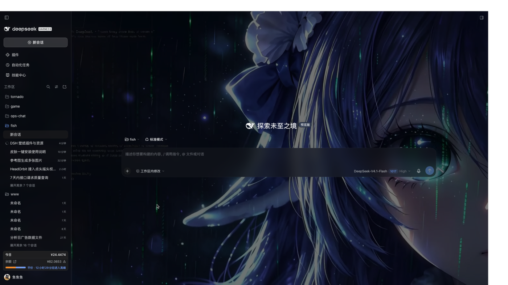
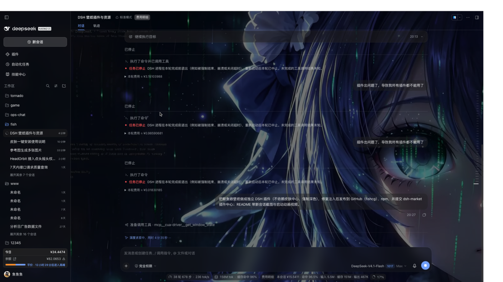
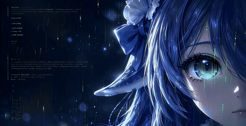

# 鲸鱼娘 · 仅壁纸（DSH 皮肤）

[](https://github.com/fishcg/dsh-whale-wallpaper-skin)
[](https://www.npmjs.com/package/dsh-whale-wallpaper-skin)
[](LICENSE)

只换壁纸、不动排版的 DSH 深色皮肤。开场视频播放 11 秒后定格并压暗，输入卡 / 左侧栏 / 代码块 / 右侧面板是毛玻璃，设置弹窗用一张半透明插画做背景；其余字体、字号、文字颜色全部沿用 DSH 默认深色主题。





## 开场动画



完整背景视频

## 特性

- **11 秒开场**：纯 CSS 动画（`animation-delay: 11s`）——视频隐藏、定格图淡入、背景纱与会话暗底同时压暗；不修改 DSH 本体
- **毛玻璃**：输入卡 `rgba(20,22,28,.6)` + `blur(22px)`；左侧栏 `.28` + `blur(20px)`；代码块 `.46` + `blur(30px)`；右侧面板 `.45` + `blur(18px)`
- **气泡**：用户与助手都接近不透明，只留一点壁纸蓝调
- **设置弹窗**：指定插画 + `rgba(10,12,18,.82)` 遮罩，保证文字可读
- **默认主题**：除上述表面外不覆盖任何字体/间距/配色

## 安装

需要皮肤中心 `@linxin666/dsh-client-ui-skin-center`（dsh-web 自带；桌面版 profile 已装）。

```bash
# 解压后
bash install.sh
```

或双击 `Install.command`。也可以直接装 npm 包拿到全部皮肤文件：

```bash
npm i dsh-whale-wallpaper-skin   # 或 npm pack dsh-whale-wallpaper-skin
```

脚本会：

1. 找到皮肤目录：`${DSH_SKINS_HOME:-${DSH_SKINS_DIR:-${DSH_HOME:-~/.dsh}/skins}}`
2. 从 OSS 下载视频与两张图（仓库里不含大文件）
3. 拷入 `skin.json` / `skin.css` / `patches.css` / `preview`

装完在 **设置 → 皮肤 → 鲸鱼娘 · 仅壁纸 → 应用**。卸载：删掉皮肤目录，再切回「官方默认」。

| 资源 | 大小 | 地址 |
| --- | --- | --- |
| 背景视频 | 6.3 MB | https://acgay.oss-cn-hangzhou.aliyuncs.com/dsh-skins/whale-wallpaper/assets/whale-fantasy-loop.mp4 |
| 11s 定格图 | 212 KB | https://acgay.oss-cn-hangzhou.aliyuncs.com/dsh-skins/whale-wallpaper/assets/whale-wallpaper-11s.jpg |
| 设置弹窗背景 | 71 KB | https://acgay.oss-cn-hangzhou.aliyuncs.com/dsh-skins/whale-wallpaper/assets/settings-bg.webp |

## 调整

改 `patches.css` 末尾的区块即可，改完在 设置 → 皮肤 里切换一次皮肤重载：

- 输入卡：`body [data-composer-card]`
- 左侧栏：`body [class*='sidebarCol']`
- 代码块：`body [data-chat-flow] div:has(> [data-code-block-banner])`
- 右侧面板：`body [data-sidebar-right-panel][data-sidebar-right-open]:has([data-sidebar-right-tab])`
- 助手回复底：`body [data-chat-flow-kind='assistant-step']`
- 设置弹窗：`dialog, [role='dialog']`
- 开场时间：`wp-still-in` / `wp-hide-video` / `wp-veil-in` / `wp-scrim-in` 共 4 处 `11s`

## 许可

皮肤工程规则、调色板与几何约定：**stushansusu**，[CC BY-NC-SA 4.0](https://creativecommons.org/licenses/by-nc-sa/4.0/)。

背景视频与插画由原作者提供，同样以 CC BY-NC-SA 4.0 共享；仅供个人非商业使用，转载需署名并以相同协议共享。
